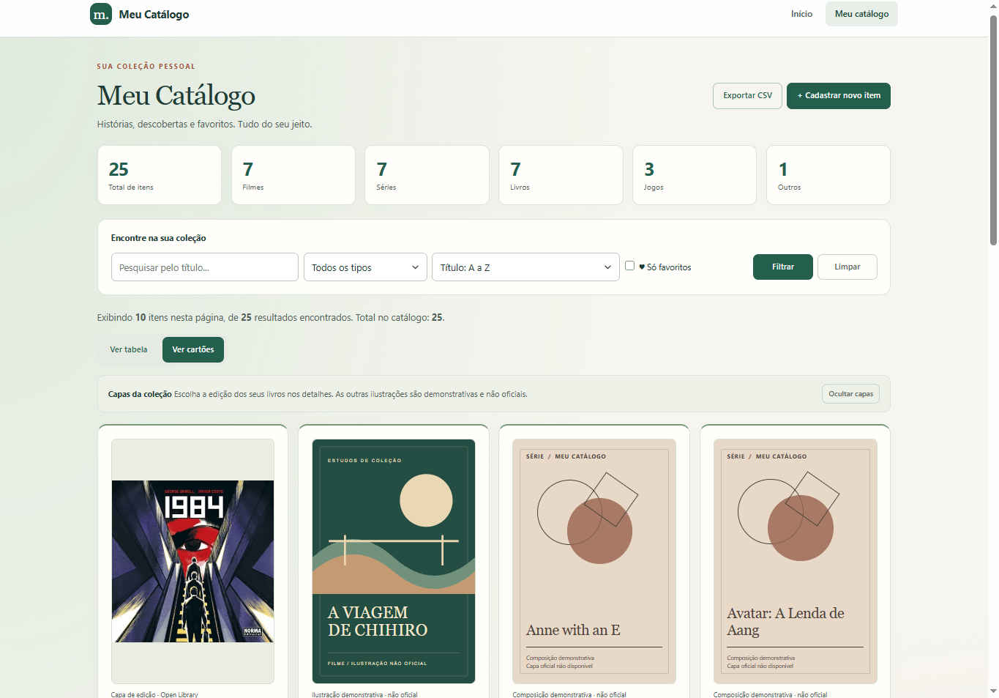
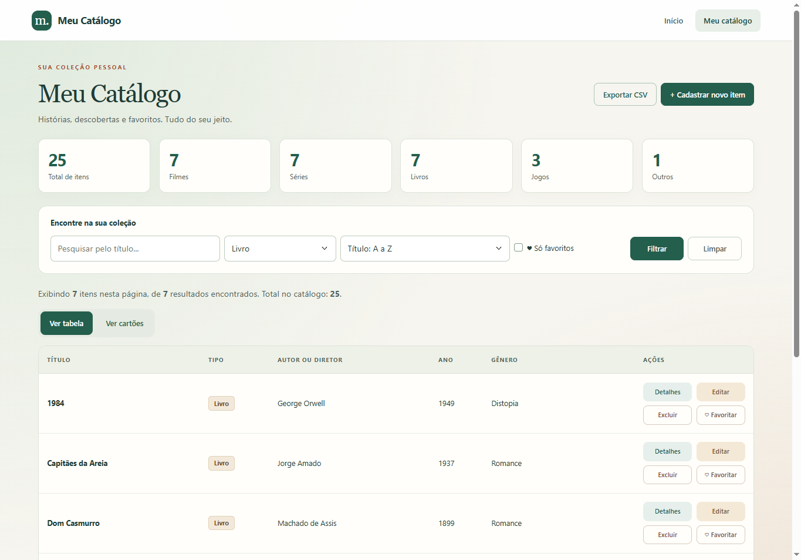
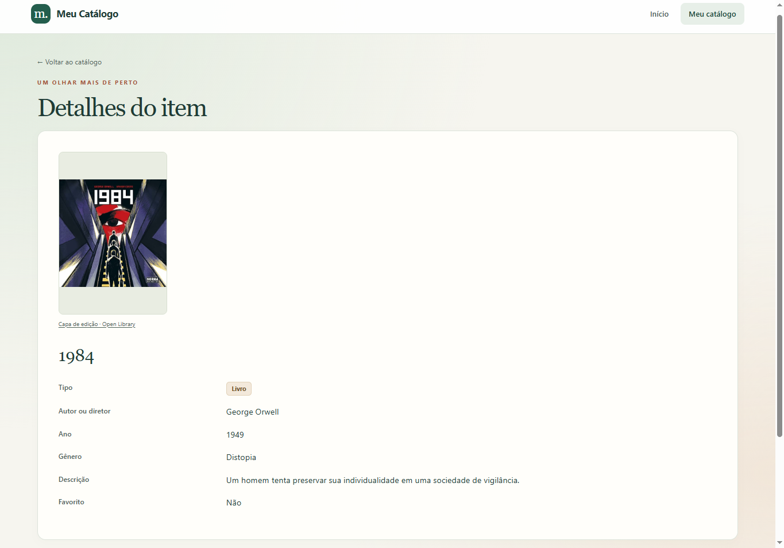
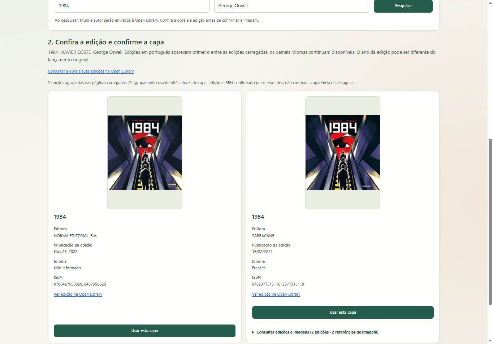

# Meu Catálogo

Aplicação web para organizar filmes, séries, livros, jogos e outros conteúdos. Desenvolvida com C# e ASP.NET Core MVC, reúne persistência relacional, exportação CSV e seleção de capas de livros pela Open Library.

Projeto de estudo e portfólio backend, com execução local, interface Razor e testes automatizados. A versão atual não possui autenticação nem separação de catálogos por usuário.


## Funcionalidades

- Cadastro, consulta, edição e exclusão com confirmação e validação de formulários.
- Pesquisa por título, filtros por tipo e favoritos, ordenação por título ou ano e paginação.
- Estatísticas do catálogo e visualizações em tabela ou cartões, com preferência salva no navegador.
- Exportação CSV de todos os resultados filtrados, independentemente da página exibida.
- Pesquisa de capas de livros por título e autor, consulta de edições e confirmação manual da imagem.
- Associação de capa persistida, com créditos, links da fonte e apresentação substituta quando não há imagem.
- Conjunto opcional de 25 exemplos, inseridos sem atualizar registros existentes com o mesmo título e tipo.

### Organização e consulta

O catálogo reúne tipos diferentes em cartões, com capas de livros e composições substitutas. As ilustrações demonstrativas dos demais conteúdos são identificadas como não oficiais.



Na tabela, os filtros e a ordenação permitem consultar a coleção. A exportação CSV considera todos os resultados filtrados, além da página exibida.



### Capas de livros pela Open Library

A capa escolhida fica associada ao item e aparece nos detalhes com crédito e link da fonte.



Na seleção, o usuário confere editora, publicação, idioma e ISBN antes de confirmar. Opções agrupadas preservam o acesso às edições e imagens individuais; o agrupamento não compara a aparência das capas.



## Tecnologias

| Área | Tecnologias |
| --- | --- |
| Backend | C#, .NET 10, ASP.NET Core MVC |
| Persistência | Entity Framework Core 10.0.14, SQL Server Express LocalDB |
| Interface | Razor Views, Bootstrap 5.3.3 via CDN, HTML, CSS e JavaScript |
| Integração | Open Library, HttpClient, configuração por injeção de dependência |
| Testes | xUnit, Microsoft.NET.Test.Sdk, SQLite em memória e HTTP simulado |

## Decisões técnicas

- **Consultas consistentes:** listagem e exportação compartilham filtros e ordenação. A paginação limita a tela, não o CSV.
- **CSV para uso em planilhas:** UTF-8 com BOM, separador `;`, cabeçalhos em português e favoritos como Sim/Não. Campos recebem escape de aspas e quebras de linha e proteção contra interpretação como fórmula.
- **Integração controlada:** o cliente da Open Library trata falhas, cache e limites de requisições. A seleção é manual para permitir conferir obra e edição; o agrupamento usa identificadores e metadados, sem reconhecimento visual.
- **Persistência de capas separada:** `CatalogItemCover` mantém uma associação opcional ao item, sem incluir seus metadados no CSV. A gravação utiliza transação e controle de concorrência.
- **Seed com ativação explícita:** desativado por padrão, inclusive em Development. Só executa com Development e `CatalogSeed:Enabled=true`.
- **Testes isolados:** persistência em SQLite em memória e respostas HTTP simuladas, sem depender do banco principal ou da internet.

## Arquitetura MVC

| Componente | Responsabilidade |
| --- | --- |
| Models e ViewModels | Entidades, validações e dados apresentados nas telas |
| Controllers | Requisições HTTP, validação das entradas e respostas em páginas ou arquivos |
| Views | Interface Razor, formulários e componentes visuais |
| ApplicationDbContext | Mapeamento e acesso relacional pelo EF Core |
| Services | Exportação CSV e pesquisa, seleção e persistência das capas |
| Program.cs | Registro de serviços, configuração e pipeline HTTP |

O projeto usa injeção de dependência. O `CatalogSeedStartup` verifica a autorização de execução antes de resolver o contexto; o `CatalogSeedData` mantém a inserção dos exemplos. A aplicação não aplica migrations automaticamente.

```text
Controllers/                  Ações MVC
Models/                       Entidades e ViewModels
Views/                        Páginas Razor e parciais
Data/                         DbContext, proteção e dados demonstrativos
Services/                     CSV e integração de capas
Migrations/                   Evolução do esquema
wwwroot/                      CSS, JavaScript e ilustrações locais
tests/MyCatalog.Tests/        Testes automatizados
docs/                        Guias complementares
```

## Testes

**Última validação registrada: 118 testes aprovados, sem falhas ou casos ignorados; build sem avisos ou erros.** Esse resultado não representa cobertura total da aplicação.

A suíte verifica formatação e segurança do CSV; repetição e preservação de dados no seed; sua proteção de inicialização; respostas e erros da Open Library; relevância, idiomas e agrupamento de edições; seleção, persistência e concorrência das capas.

```powershell
dotnet build
dotnet test
```

No Visual Studio: **Teste > Gerenciador de Testes > Executar Todos**. Os testes não iniciam a aplicação nem acessam o LocalDB. A suíte não cobre toda a navegação MVC, a interface ou particularidades de concorrência do SQL Server. Consulte [os detalhes dos testes](tests/MyCatalog.Tests/README.md).

## Execução local

### Pré-requisitos

- Windows e SQL Server Express LocalDB, instância `MSSQLLocalDB`.
- SDK .NET 10.
- Visual Studio compatível com .NET 10 e soluções `.slnx`, caso utilize a IDE.
- Internet para restaurar pacotes, carregar o Bootstrap via CDN e usar a Open Library.
- Acesso ao repositório, enquanto ele permanecer privado.

### Preparação

```powershell
git clone https://github.com/Lostwallett/Meu-Catalogo.git
cd Meu-Catalogo
dotnet restore
dotnet build
```

Confira `ConnectionStrings:DefaultConnection` em `appsettings.json`. A configuração padrão usa LocalDB com autenticação integrada do Windows, sem senha. É possível sobrescrevê-la pela variável `ConnectionStrings__DefaultConnection`.

Para uma instalação nova, prepare um banco exclusivo de demonstração conforme o [guia de configuração e esquema](docs/CAPAS-OPEN-LIBRARY.md). O projeto contém `InitialCreate` e `AddCatalogItemCover`. Se já estiverem aplicadas ao banco escolhido, não as execute novamente. A fábrica de design exige uma conexão isolada explícita e bloqueia o banco principal configurado no projeto.

### Iniciar

Abra `MyCatalog.slnx`, selecione o projeto **MyCatalog** e o perfil **https**, depois pressione F5. Pelo terminal:

```powershell
dotnet run --project MyCatalog.csproj --launch-profile https
```

Acesse `https://localhost:7157`. Se necessário, configure o certificado de desenvolvimento com `dotnet dev-certs https --trust`.

O perfil usa Development, mas não habilita o seed. Confira se a IDE não herdou `CatalogSeed__Enabled=true`; mantenha-o ausente ou explicitamente falso para usar dados existentes. O log deve informar `Dados demonstrativos desativados`.

## Configuração opcional

| Configuração | Variável de ambiente | Padrão e efeito |
| --- | --- | --- |
| `BookCovers:Enabled` | `BookCovers__Enabled` | `false`; habilita o mecanismo de capas de livros |
| `BookCovers:ContactEmail` | `BookCovers__ContactEmail` | Vazio; contato válido necessário para enviar pesquisas à Open Library |
| `CatalogSeed:Enabled` | `CatalogSeed__Enabled` | `false`; executa o seed somente quando explicitamente verdadeiro e em Development |

Forneça o contato fora dos arquivos versionados. Ele é transmitido à Open Library para identificação das requisições. Sem habilitação e contato válido, a pesquisa não envia chamadas. A associação persiste, mas as imagens são remotas e dependem da disponibilidade da fonte. Ilustrações locais de filmes, séries e jogos são demonstrativas e não oficiais.

Habilite o seed apenas ao popular um banco de demonstração com esquema já preparado. Ele não cria o banco; compara título e tipo e insere exemplos ausentes. Alterar esses campos pode fazer o exemplo original ser considerado ausente em uma execução posterior. A opção não impede que uma conexão incorreta seja escolhida.

As instruções completas de variáveis temporárias, preparação e validação estão nos guias abaixo.

## Documentação complementar

- [Open Library: configuração, esquema e decisões técnicas](docs/CAPAS-OPEN-LIBRARY.md)
- [Validação manual de capas no Visual Studio](docs/TESTE-MANUAL-CAPAS.md)
- [Estudo técnico: agrupamento de edições de 1984](docs/AGRUPAMENTO-CAPAS-1984.md)
- [Testes automatizados](tests/MyCatalog.Tests/README.md)

## Melhorias futuras

Ainda não implementadas:

- Autenticação e catálogos por usuário.
- Mais testes dos fluxos HTTP e de interface.
- Integração contínua para build e testes.
- Configuração de implantação e banco para produção.
- Integração de capas de filmes, séries e jogos.
